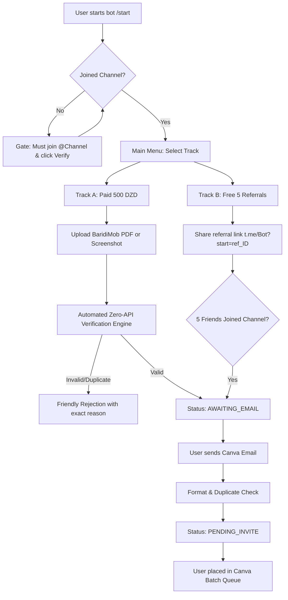

# 🎨 Canva 500-Seat Distribution System (Algeria 🇩🇿)

A production-grade, self-hosted, zero-external-API Telegram bot and web administration dashboard designed for fully automated distribution of **500 Canva seats in Algeria**.

The system operates with **zero human intervention** until the final step of uploading the collected email batch into the Canva Admin console.

---

## ⚡ Key Highlights & Architecture

- **Language & Frameworks**: Python 3.10+ using `pyTelegramBotAPI` (`telebot`) and `FastAPI` (serving the web dashboard & API concurrently with `uvicorn`).
- **Database**: SQLite (`canva_system.db`) with automatic table creation, WAL mode, foreign keys, and transaction-safe queries.
- **Zero-API / Zero-Cost Receipt Verification**:
  - **SHA-256 Deduplication**: Immediate rejection of re-used receipt files.
  - **Direct PDF Text Parsing**: Instant text extraction via `pypdf` for BaridiMob "Télécharger le reçu" PDFs.
  - **Local OCR Fallback**: `pytesseract` + Pillow contrast enhancement for mobile screenshots.
  - **4-Point Rule Engine**: Destination RIP/CCP match, exactly 500.00 DZD, date today or yesterday, unique transaction ID.
- **Dual-Track Access System**:
  - **Track A (Paid Access - 500 DZD)**: Direct BaridiMob transfer with automated receipt validation.
  - **Track B (Paid Affiliate Rewards - Freebies)**: Only active members who purchased Canva get access to referral links. For every **5 paying friends** they refer, they unlock an exclusive **Freebie Reward** (free digital gift / pack) queued for admin fulfillment.
- **Admin Control Center**:
  - Sleek, dark-mode **Web Dashboard** with real-time capacity progress bar (`X/500 seats`), audit table, and CSV export.
  - Telegram admin commands (`/stats`, `/export_csv`, `/pending_emails`, `/mark_invited`, `/bulk_mark_invited`, `/broadcast`).
  - **Canva Batch Export**: Generates `canva_invites_batch.csv` ready for 1-click team invitation in Canva.

---

## 📁 Repository Structure

```
CanvaBot/
├── .env.example              # Sample environment configuration
├── config.py                 # Pydantic settings loader & validation
├── database.py               # SQLite schema, connection management, queries
├── receipt_verifier.py       # BaridiMob zero-API verification engine (PDF/OCR)
├── bot.py                    # Telegram bot handlers, keyboards, channel gate
├── dashboard.py              # FastAPI admin portal, API endpoints, web UI
├── main.py                   # Master process launching bot + web server
├── requirements.txt          # Pinned Python package dependencies
├── Dockerfile                # Production Docker container with Tesseract OCR
├── docker-compose.yml        # Multi-platform deployment file
├── Procfile                  # Deployment configuration for Render / Railway
├── tests/                    # 100% passing unit & integration test suite
│   ├── test_database.py
│   ├── test_receipt_verifier.py
│   ├── test_email_validator.py
│   ├── test_pdf_verification.py
│   └── test_dashboard_api.py
└── README.md                 # Complete operations manual
```

---

## 🛠️ Step-by-Step Setup Guide

### 1. Prerequisites
- Python 3.10, 3.11, 3.12, or 3.13.
- (Optional for OCR) Tesseract OCR engine (bundled automatically in the Docker container).

### 2. Create Telegram Bot & Channel
1. Open Telegram and message [@BotFather](https://t.me/BotFather).
2. Send `/newbot`, name your bot (e.g., `CanvaProAlgeriaBot`), and copy the **Bot Token**.
3. Create your Telegram channel (e.g., `@CanvaAlgerieHub`).
4. **Important**: Add your bot as an **Administrator** in your channel so it has permissions to check member status via `getChatMember`.
5. Find your personal Telegram numeric ID using [@userinfobot](https://t.me/userinfobot) (this will be your `ADMIN_ID`).

### 3. Local Installation
Clone or navigate to the project directory:

```bash
cd d:\Projects\CanvaBot

# Create virtual environment (recommended)
python -m venv venv
# On Windows:
venv\Scripts\activate
# On Linux/macOS:
source venv/bin/activate

# Install dependencies
pip install -r requirements.txt
```

### 4. Configure Environment Variables
Copy `.env.example` to `.env`:

```bash
cp .env.example .env
```

Edit `.env` with your credentials:

```ini
# Telegram Settings
BOT_TOKEN=7123456789:ABCdefGhIJKlmNoPQRsTUVwxyZ
ADMIN_ID=987654321
REQUIRED_CHANNEL=@CanvaAlgerieHub
CHANNEL_INVITE_LINK=https://t.me/CanvaAlgerieHub

# BaridiMob Account Settings
TARGET_RIP=00799999000123456789
TARGET_CCP=1234567890
ACCOUNT_HOLDER=BEN MOHAMED AHMED
PAYMENT_AMOUNT=500.0
DATE_GRACE_DAYS=2

# Seat Limits
MAX_SEATS=500
REQUIRED_REFERRALS=5

# Admin Dashboard
PORT=8000
ADMIN_USERNAME=admin
ADMIN_PASSWORD=your_secure_password_here
```

### 5. Run the System

```bash
python main.py
```

The system will:
1. Initialize the SQLite database `canva_system.db`.
2. Connect to Telegram and begin processing messages and receipts in the background.
3. Start the FastAPI Web Dashboard on `http://localhost:8000`.

---

## 🌐 Web Dashboard Access

Open your browser at `http://localhost:8000/dashboard` (or `http://your-server-ip:8000/dashboard`).

- **Username**: Value of `ADMIN_USERNAME` (default: `admin`)
- **Password**: Value of `ADMIN_PASSWORD` (default: `canvapro2026`)

### Dashboard Features:
- **Visual Capacity Gauge**: Real-time progress bar of the 500-seat allocation.
- **Metric Cards**: Total users, paid accounts, referral unlocks, revenue in DZD, and pending queue.
- **Ready to Invite Queue**: Table of users awaiting Canva email invite with a 1-click **"Mark Invited"** button.
- **CSV Download**: One-click download of `canva_invites_batch.csv`.
- **Bulk Mark**: Button to mark all pending users as invited once uploaded to Canva.

---

## 🤖 Telegram User & Admin Workflows

### User Journey (Zero Human Touch)



### Administrator Commands (Telegram)
Only the user matching `ADMIN_ID` can execute these commands:
- `/admin`: Interactive control panel with inline action buttons.
- `/stats`: Seat stats, capacity percentage, and revenue breakdown.
- `/export_csv`: Generates and sends `canva_invites_batch.csv` directly into the chat as a document.
- `/pending_emails`: Lists up to 25 verified emails waiting for Canva invitations.
- `/mark_invited <email>`: Marks a user as invited and sends them an automatic congratulatory Telegram DM.
- `/bulk_mark_invited`: Transitions all pending users to `INVITED`.
- `/broadcast <message>`: Broadcasts an announcement to all registered bot users.

---

## 🔍 BaridiMob Verification Engine Mechanics

When a user submits a receipt:
1. **Hash Check**: SHA-256 hash is computed. If found in `used_receipts`, it is immediately rejected (`DUPLICATE_HASH`).
2. **Text Extraction**:
   - `.pdf` files are processed in-memory using `pypdf.PdfReader`.
   - Image screenshots are preprocessed (grayscale + 2x contrast boost) and read locally using `pytesseract`.
3. **Four Automated Validation Rules**:
   - **Rule 1 (Destination Account)**: The receipt destination field (`Compte à créditer`, `Vers`, `Bénéficiaire`, or `RIP`) must match the configured `TARGET_RIP` or `TARGET_CCP`.
   - **Rule 2 (Amount)**: The amount must equal `500.00 DZD` (supports formats like `500,00 DZD`, `500 DZD`, `500.00 DA`).
   - **Rule 3 (Date Window)**: Transaction date must be within `DATE_GRACE_DAYS` (today or yesterday) to prevent submission of old receipts.
   - **Rule 4 (Transaction ID)**: The unique transaction ID (e.g. `N° de transaction : 20261030...`) is extracted and checked against `used_receipts` to prevent reuse.
4. **Instant Unlock**: Upon passing all 4 rules, the receipt is recorded, and the bot immediately prompts for the user's Canva email.

---

## 🎨 Adding Collected Emails to Canva (Batch Invite)

When users submit their emails, they enter the `PENDING_INVITE` state. To invite them in bulk:

1. Click **Export Canva CSV** on the Web Dashboard or send `/export_csv` in Telegram.
2. Open your browser and go to your **[Canva Team Settings](https://www.canva.com/settings/team-members)**.
3. Click **"Invite members"**.
4. Copy the emails from `canva_invites_batch.csv` or upload the CSV.
5. In your bot or web dashboard, click **"Bulk Mark All as Invited"** (or `/bulk_mark_invited`).
   - The seat counter updates accurately.
   - Users receive automatic confirmation that their invite has been sent.

---

## 🚀 Cloud Deployment Options

### Option A: Docker / VPS (Recommended for Algeria & Production)

```bash
# 1. Clone repository to your VPS
git clone <your-repo> /opt/canvabot
cd /opt/canvabot

# 2. Configure .env
cp .env.example .env
nano .env

# 3. Build and launch container
docker compose up -d --build

# 4. View live logs
docker compose logs -f
```

Data is stored persistently in `./data/canva_system.db`.

### Option B: Render.com
1. Create a new **Web Service** connected to your repository.
2. Environment: **Python 3**.
3. Build Command: `pip install -r requirements.txt`.
4. Start Command: `python main.py`.
5. Add Environment Variables from your `.env` (Render automatically sets `PORT`).

### Option C: Railway.app
1. Create a new project from your GitHub repo.
2. Railway will automatically detect the `Procfile` or `Dockerfile`.
3. Add your environment variables in the Railway dashboard settings.

---

## 🧪 Running Automated Tests

Run the full unit and integration test suite:

```bash
python -m unittest discover -s tests -v
```

All 21 tests cover:
- SQLite schema, thread safety, and foreign key integrity.
- Automated referral verification and self-referral prevention.
- Email format validation and seat allocation arithmetic.
- Full BaridiMob PDF generation, text extraction, and deduplication.
- Regex extraction for Arabic & French transaction IDs, dates, and amounts.
- FastAPI authentication, health checks, and CSV download endpoints.
